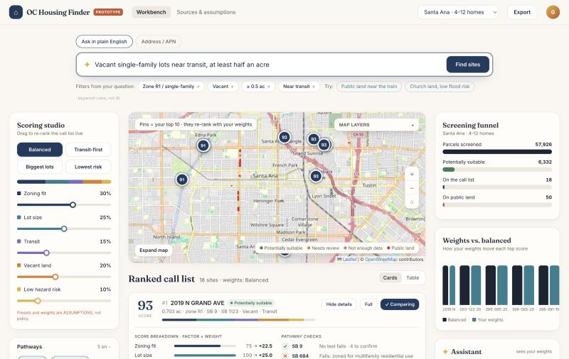
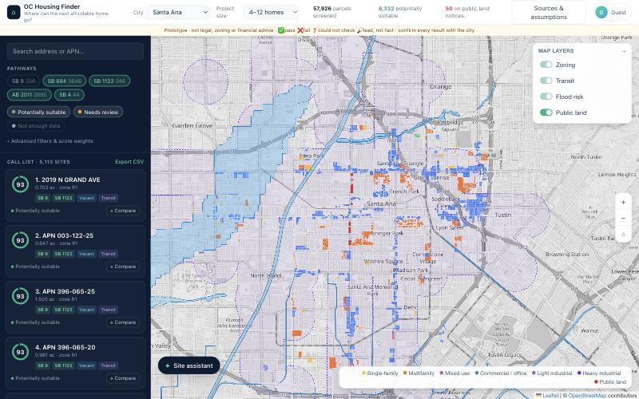
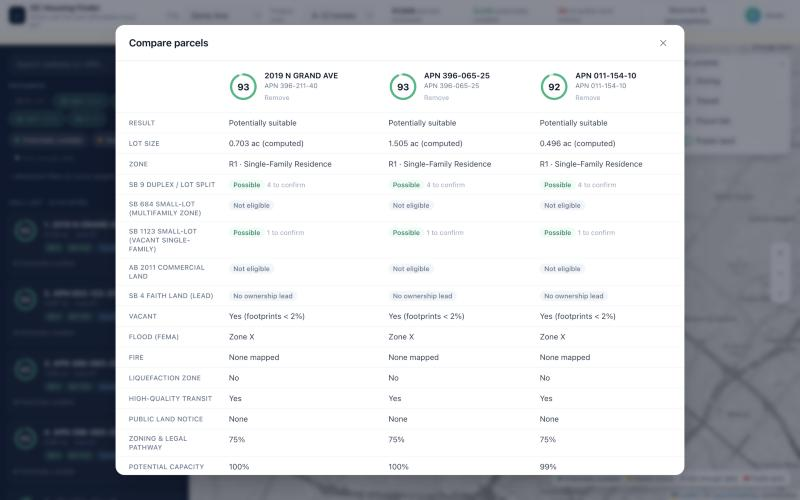
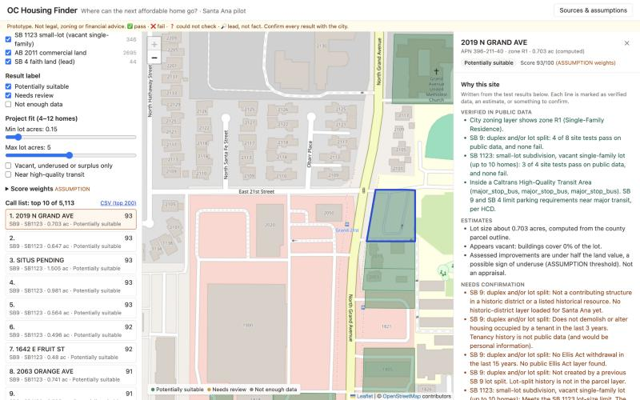
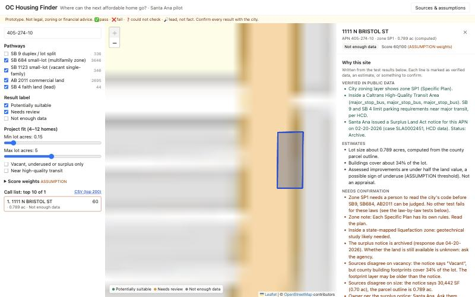

# OC Housing Finder

> For a nonprofit acquisitions lead with no GIS team: a map of every Santa Ana parcel that California's
> land-opening housing laws might unlock, with a pass / fail / unknown answer for each site test, and the source for each one.

**Code:** [`lanes/1-find-it/oc-housing-finder/`](lanes/1-find-it/oc-housing-finder) · **Event info:** [docs/EVENT-README.md](docs/EVENT-README.md)

**Team:** OC Housing Finder
**Members:** Angelina Alcantra Pao, Harshal
**Lane:** 1 Find it
**Built at:** Claude Impact Lab: UCI × SoCal Affordable Housing, November 7, 2026

> **Prototype.** Not legal, zoning, environmental or financial advice. Every parcel-level result
> must be checked with the city and a professional.

## The real user

A one-person acquisitions team at a small housing nonprofit (scenario F02 in `lanes/1-find-it/scenarios.json`,
a made-up user): *"Give me ten sites in one city I should call about this month, and why each one."*
They know SB 9, SB 684, AB 2011 and SB 4 exist, but connecting a law's stacked site tests to a
specific parcel means opening 5-10 different maps, and nobody on staff knows GIS.

**Before:** sites come by luck: a city calls about surplus land, or a church offers its parking lot.
**After:** they open one map of Santa Ana, filter to 4-12 home pathways, export a ranked call list, and
open any parcel to see which tests passed, which failed and which no public data can answer. Each test links to the
HCD fact sheet it came from, and there's a draft question for city planning they can copy.

## What we built

- **Law-by-law site tests** for SB 9, SB 684, SB 1123, AB 2011 and SB 4 ([`rules/laws.json`](lanes/1-find-it/oc-housing-finder/rules/laws.json)). Each test
  quotes the HCD Housing Law Fact Sheet (April 2026) it comes from and returns ✅ pass, ❌ fail,
  ❓ could not check, or 🔎 lead, not fact.
- **"Legal but usable?"** checks next to each site: FEMA flood zone, fire hazard zone, liquefaction
  and landslide zones, vacancy from building footprints, high-quality transit.
- **A church-land lead for SB 4:** OpenStreetMap places of worship inside a parcel, labelled *lead, not fact*,
  because owner type is not in any free parcel layer.
- **Cleaned surplus-land notices:** HCD Surplus Land Act rows for Santa Ana, joined to parcels by
  APN, sizes like `"9,005 SF"` parsed into acres, and archived notices flagged.
- **Source conflicts shown, not hidden:** when the city's zoning layer and SCAG's 2024 layer disagree, the parcel
  is marked *Needs review*.
- **Transparent score** with adjustable weights (labelled ASSUMPTION), a ranked call list of
  parcel cards with score rings, CSV export, and a plain-language "why this site" split into
  *verified / estimate / needs confirmation*.
- **Map layers you can toggle:** zoning (colored by zone type), Caltrans high-quality transit
  areas, FEMA flood hazard areas, and public land (surplus-land notices).
- **Hover** any parcel for its address and score. **Click** for the full panel.
- **Site assistant on the map:** ask about the selected parcel ("What could block it?",
  "Which law fits best?", "Who should I call?"). In this build it answers only from that parcel's
  screening data, with no LLM, so it cannot invent facts. It says so on screen.
- **Compare up to 3 parcels** side by side: every law, hazard, vacancy and score component.
- **Ask in plain English:** "Vacant single-family lots near transit, at least half an acre" becomes
  removable filter chips (R1, Vacant, ≥ 0.5 ac, Near transit). This uses keyword rules, not AI, and says so.
- **Scoring studio:** presets (Balanced, Transit-first, Biggest lots, Lowest risk) and per-factor
  sliders re-rank the call list and the map pins live. A screening funnel and a "weights vs.
  balanced" chart show what your weights change.
- **Ranked call list:** each card has a stacked factor × weight bar, an inline breakdown
  (points per factor) and pathway checks taken from the real test results (✓ / ? / ✕ with the failing test).



| Map layers: zoning, transit, flood, public land | Compare up to 3 parcels |
|---|---|
|  |  |



**Demo video:** [link]
**Live demo:** [optional]

## Real test case: 1111 N Bristol St, Santa Ana (city surplus land)

**Why this site:** the City of Santa Ana itself offered it for sale. It is one of 14 parcels in HCD
Surplus Land Act case **SLA0002451** (notice issued 02-20-2026, responses due 04-20-2026, now marked
"Archive"), described in the notice as vacant, "Open Space with Commercial Option".
Source: HCD Surplus Land Act Notices of Availability, data.ca.gov, downloaded 2026-11-07.



| What the tool checked | Result | Source |
|---|---|---|
| Zoning | SP1, Bristol Street Corridor Specific Plan, so ❓ for SB 9, SB 684 and AB 2011 until someone reads the plan | Santa Ana zoning layer; SCAG 2024 agrees (SP1) |
| Size | 0.789 ac from the parcel outline vs **30,442 SF (0.70 ac)** in the notice: **sources disagree** | OC parcels; HCD notice |
| Vacancy | Notice says "Vacant", but **county footprints cover 34%** of the lot: **sources disagree**. Because the tool trusts footprints, SB 1123 shows ❌ "not vacant", which may be wrong | HCD notice; OC Building Footprints |
| Flood | ✅ FEMA zone X (not a special flood hazard area) | FEMA NFHL |
| Fire | ✅ no fire hazard zone mapped (layer may predate CAL FIRE's 2025 maps) | OC LRA, CAL FIRE SRA |
| Liquefaction | ⚠️ inside a state-mapped liquefaction zone, so a geotechnical study is likely | CGS via OC |
| Transit | ✅ inside a High-Quality Transit Area (major bus stops), so less parking can be required under SB 9 and SB 4 | Caltrans HQTA |
| SB 4 | No place of worship mapped; owner is the city, so SB 4 does not apply | OSM; HCD notice |
| Still available? | ❓ unknown: the notice is archived | HCD notice |

**What we learned:** the one parcel the city has publicly offered can't be judged by a
state-law screen alone. It sits in a specific plan, and two public sources disagree about its size
and whether it is vacant. That is exactly where nonprofits lose time. The tool shows the
disagreement, names who owns it (the city), and drafts the question to ask Santa Ana Planning.
Encoding the Bristol Street Corridor Specific Plan as a city rules layer is the obvious next step.
About 12,000 Santa Ana parcels are in zones marked "needs review" (specific plans, specific developments, R2, the Metro East overlay).

## How Claude is used

- **Building it:** Claude (Claude Code) read the HCD fact sheets, turned each law into tests with quotes,
  inspected every data layer's fields, and wrote the pipeline and the app with the team.
- **At runtime:** the "why this site" text, the site assistant's answers and the draft email are built from the test results,
  so the tool works with no API key and every sentence traces to a test. A person must confirm
  every ❓ item, ownership, and the city's objective standards.

## Try it

You need **Node.js 18+** (https://nodejs.org) and git. The screened data is already in the repo, so no
accounts or keys are needed.

```bash
git clone https://github.com/beachrover1/claude-impact-lab-uci.git
cd claude-impact-lab-uci/lanes/1-find-it/oc-housing-finder/app
npm install
npm run dev
# open http://localhost:3000
```

To rebuild the data from the public sources (about 5 minutes; needs Python 3.9+), from the repo root:

```bash
cd lanes/1-find-it/oc-housing-finder
python3 -m venv .venv && .venv/bin/pip install -r pipeline/requirements.txt
.venv/bin/python pipeline/fetch_data.py      # downloads and caches into data/raw/ (not committed)
.venv/bin/python pipeline/screen.py          # writes app/public/data/
```

## Sources and assumptions

| Item | Source or assumption | Date checked |
|---|---|---|
| SB 9 tests | HCD fact sheet, Duplexes and Lot Splits (SB 9), Gov. Code §§ 65852.21, 66411.7: https://www.hcd.ca.gov/sites/default/files/docs/planning-and-community/lot-splits-and-duplexes-sb-9.pdf | 2026-11-07 |
| SB 4 tests | HCD fact sheet, Faith & Higher Education Lands Act, Gov. Code § 65913.16: https://www.hcd.ca.gov/sites/default/files/docs/planning-and-community/aff-hsg-faith-higher-ed-sb-4.pdf | 2026-11-07 |
| SB 684 / SB 1123 tests | HCD Housing Law Fact Sheets (combined), Starter Home Revitalization Act, Gov. Code §§ 65852.28, 65913.4.5, 66499.41: https://www.hcd.ca.gov/sites/default/files/docs/planning-and-community/housing-law-fact-sheets.pdf | 2026-11-07 |
| AB 2011 tests | Same combined PDF, AB 2011 section, Gov. Code §§ 65912.100-65912.140 | 2026-11-07 |
| Parcels | Santa Ana Assessor Parcels (owner-name and mailing-address fields deliberately not downloaded): https://gis.santa-ana.org/server/rest/services/Public/GIS_AssessorParcels/MapServer/0 | 2026-11-07 |
| Zoning (primary) | Santa Ana Zoning Classifications: https://gis.santa-ana.org/server/rest/services/Public/PBA_ZoningClassifications/FeatureServer/0 | 2026-11-07 |
| Zoning (second source) | SCAG Zoning_poly_OR (2024): https://maps.scag.ca.gov/scaggis/rest/services/LDX/Zoning_poly_OR/MapServer | 2026-11-07 |
| Building footprints | OC Building Footprints: https://www.ocgis.com/arcpub/rest/services/Map_Layers/Building_Footprints/MapServer/0 | 2026-11-07 |
| Flood | FEMA NFHL layer 28: https://hazards.fema.gov/arcgis/rest/services/public/NFHL/MapServer | 2026-11-07 |
| Fire | OC Fire Hazard Severity Zones LRA + CAL FIRE SRA (2007). CAL FIRE's 2025 LRA maps not loaded | 2026-11-07 |
| Liquefaction / landslide | OC Liquefaction (CGS county copy); CGS Landslide Zones | 2026-11-07 |
| Transit | Caltrans CA HQ Transit Areas | 2026-11-07 |
| Surplus land | HCD Surplus Land Act Notices of Availability (data.ca.gov) | 2026-11-07 |
| Places of worship | OpenStreetMap `amenity=place_of_worship` via Overpass (ODbL) | 2026-11-07 |
| Urban area | US Census TIGERweb 2020 Urban Areas: central Santa Ana is in "Los Angeles--Long Beach--Anaheim, CA Urban Area" | 2026-11-07 |
| Score weights 30/25/20/15/10 | **ASSUMPTION**: illustrative, from our concept doc; adjustable in the app | |
| Vacant = footprints cover < 2% | **ASSUMPTION** | |
| "Possibly underused" = improvements < 50% of land value | **ASSUMPTION**: weak signal in OC, where land value dominates | |
| Capacity score = acres / 0.5, capped | **ASSUMPTION**: not a density calculation | |
| SB 9-only parcels shown only if vacant or surplus | **ASSUMPTION**: SB 9 alone allows at most 4 units | |
| Scoring presets (Transit-first, Biggest lots, Lowest risk) | **ASSUMPTION**: illustrative weight sets, not policy | |
| Project size presets: 4–12 homes = 0.15–5 ac; 13–50 homes = 0.5–10 ac | **ASSUMPTION**: lot-size ranges, not a density calculation | |
| Zone categories (R1 = single-family, etc.) | **ASSUMPTION**: our reading of the city's zone descriptions; RE treated as single-family; R2, specific plans and specific developments marked "needs review" | |

## What is real and what is mocked

| Part | Status |
|---|---|
| Parcel, zoning, hazard, transit, footprint, surplus data | Working: real public data, Santa Ana only |
| Law tests | Working for the tests listed; others always return ❓ "could not check" |
| SB 4 ownership | Lead only (places of worship). Not ownership data |
| Housing-element sites | Not available for Santa Ana (see below) |
| "Why this site" text, site assistant and draft email | Built from the test results, not an LLM. The email is never sent |
| City selector | Santa Ana only; other cities are shown as "soon" |
| User profile | "Guest" placeholder; no accounts |
| Score | Working, but the weights are ASSUMPTIONS |

## Where it gets things wrong

- **Santa Ana's housing-element sites are missing** from SCAG's regional layer (28 other OC
  jurisdictions are listed; checked 2026-11-07), so housing-element and stale-site flags are empty here.
- **Ownership is unknown.** Nothing in free data says who owns a parcel or whether they would sell.
- Tests we cannot run always show ❓: historic districts, wetlands, farmland, earthquake fault zones,
  tenancy history (not public, and would be personal information), Ellis Act withdrawals, AB 2011's detailed site
  criteria, Santa Ana's AB 2011 parcel exemptions, and SB 1123's lot-size limit (not in the fact sheet).
- **The fact sheets disagree on SB 684's lot size** ("under five acres" vs "5 acres or less"). Parcels near
  5 acres show ❓.
- Hazards are tested at one interior point of each parcel, so a parcel partly in a flood zone can be missed.
- Fire zones may be an older vintage than CAL FIRE's 2025 maps.
- Zoning categories are our reading of zone names. Zones that need review (about 12,000 parcels: specific plans, specific developments, R2) are marked
  *Not enough data* until someone reads the plan.

## Next steps

- Encode the Bristol Street Corridor Specific Plan (SP1) so city surplus land on Bristol gets real answers.
- Add the Santa Ana housing-element inventory from HCD, then a stale-site check against footprints.
- Add historic, wetlands and CGS fault-zone layers to turn more ❓ into ✅/❌.
- Encode Santa Ana's objective standards (parking, setbacks) as a city rules layer.
- Scale path: everything city-specific is in `lanes/1-find-it/oc-housing-finder/rules/city-<name>.json` plus a parcel URL. SCAG's
  zoning layer already covers all 34 OC cities, so a new city is mostly a zone-category mapping.
- Optional: Claude API for explanations, grounded only in the test results, behind an env var.

## Data and privacy

This project uses only public data. It contains no personal information about real tenants,
buyers or residents: we never download parcel owner names or mailing addresses, and surplus-notice
contacts are reduced to the agency name. It does not file applications or contact any city or person.

## License

MIT (see the LICENSE file at the repo root).
